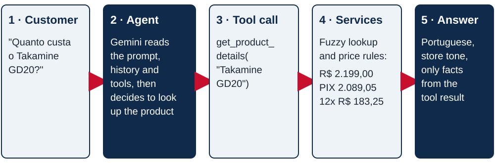

# Empório da Música — Customer Service Agent

[](https://github.com/yesi07111/IA-Engineer-Technical-Test/actions/workflows/ci.yml)

A text-based customer service agent for **Empório da Música**, a fictional musical instrument store in Campo Grande/MS, built as the written case of the Artefact selection process for the AI Engineer - Brazil position.

The agent is called **Melody**. It talks to customers in the store's friendly tone and can do the following:

- search the catalog and quote prices, promotions, PIX prices and installment plans;
- check availability and suggest alternatives when a product is sold out or discontinued;
- report the status of an order once the customer's identity is confirmed;
- tell whether an order can still be returned or exchanged;
- answer questions about store policies: payment, shipping, warranty, address and opening hours;
- hand a case over to the store team with a ticket when it can not solve it;
- politely decline requests outside the store's scope.

The agent decides by itself **when to query data** (the CSV tables) and **when to consult policies** (the PDF manual). Prices, discounts and deadlines are calculated by tested Python code, not by the language model.

**Results:**

- 15/15 evaluation scenarios passed with Gemini 3.5 Flash;
- 178 automated tests;
- CI on Python 3.11 to 3.13.

---

## Contents

1. [Quick start](#quick-start)
2. [Commands](#commands)
3. [Model provider](#model-provider)
4. [How it works](#how-it-works)
5. [Technical decisions](#technical-decisions)
6. [Data handling and assumptions](#data-handling-and-assumptions)
7. [Error handling](#error-handling)
8. [Example conversations](#example-conversations)
9. [Quality and evaluation](#quality-and-evaluation)
10. [Known limitations and next steps](#known-limitations-and-next-steps)
11. [Documentation](#documentation)
12. [Use of AI coding assistants](#use-of-ai-coding-assistants)

---

## Quick start

**Requirements:** Python 3.11 or newer and a free Gemini API key from [Google AI Studio](https://aistudio.google.com) (**Get API key → Create API key**). Other providers also work; see [Model provider](#model-provider).

```bash
git clone https://github.com/yesi07111/IA-Engineer-Technical-Test.git
cd IA-Engineer-Technical-Test
python -m venv .venv
```

Activate the virtual environment:

```bash
# Linux / macOS
source .venv/bin/activate
# Windows (PowerShell)
.venv\Scripts\Activate.ps1
```

Install the project with Gemini support, the web chat, the MCP server and the development tools:

```bash
pip install -e ".[google,web,mcp,dev]"
```

Create the configuration file and paste your key into `GEMINI_API_KEY`:

```bash
cp .env.example .env
```

Check that the data loads and the settings are complete. This step does not call the model:

```bash
emporio check
```

Start chatting in the terminal:

```bash
emporio chat --show-tools
```

Or open the web chat at http://127.0.0.1:8000:

```bash
emporio serve
```

Run every command from the project root. `.env` is ignored by git, so your key stays on your machine.

---

## Commands

| Command | What it does | Needs the model |
|---|---|---|
| `emporio chat [--session ID] [--show-tools]` | Interactive chat in the terminal. Reuse `--session` to continue a conversation. | yes |
| `emporio serve [--port 8000]` | HTTP API (`POST /api/chat`) and web chat page. API docs at `/docs`. | yes |
| `emporio mcp` | MCP server over stdio with the store tools. | no |
| `emporio check` | Loads every data file and validates the settings. | no |
| `emporio audit` | Lists data inconsistencies for the store team. | no |
| `emporio tickets` | Shows the cases the agent forwarded to the team. | no |
| `python scripts/generate_examples.py` | Regenerates the example conversations. | yes |
| `python scripts/evaluate_agent.py` | Runs the evaluation scenarios and writes `evals/report.md`. | yes |
| `python scripts/build_docs_pdf.py` | Builds the documentation PDF from this README and `docs/`. | no |

---

## Model provider

The model is set with one variable in `provider:model` format, so switching providers needs no code change.

| Provider | Install extra | `EMPORIO_MODEL` example | Key |
|---|---|---|---|
| **Google Gemini (default, free tier)** | `.[google]` | `google_genai:gemini-3.5-flash` | `GEMINI_API_KEY` or `GOOGLE_API_KEY` |
| Anthropic | `.[anthropic]` | `anthropic:claude-sonnet-5-5` | `ANTHROPIC_API_KEY` |
| OpenAI | `.[openai]` | `openai:<model-name>` | `OPENAI_API_KEY` |
| Ollama (local) | `.[ollama]` | `ollama:<model-name>` | none |

The project was developed, evaluated and used to generate the examples with **`google_genai:gemini-3.5-flash`**.

The Gemini free tier allows 5 requests per minute and 20 per day per project. Set `EMPORIO_REQUESTS_PER_MINUTE=5` so calls wait their turn instead of failing. A customer message usually needs two model calls: one to choose the tools and one to write the answer. All settings are listed in [docs/08-operations.md](docs/08-operations.md).

---

## How it works



For each message the agent receives three inputs:

- the system prompt, with the persona and the rules;
- the conversation history;
- the description of nine tools.

The model chooses which tools to call. The tools run in Python and return structured results, and the model writes the answer from them.

| Tool | Used for |
|---|---|
| `search_products` | "Which acoustic guitars do you have up to R$1000?" and "which of those have steel strings?" |
| `get_product_details` | Price, promotion, PIX price, installments, stock and specs of one product |
| `list_active_promotions` | "Do you have any promotions?" |
| `list_categories` | "What do you sell?" |
| `get_order_status` | Status, tracking code and delivery date (requires an identity check) |
| `check_return_eligibility` | "Can I still return my order?" (requires an identity check) |
| `search_store_policies` | Payment, shipping, warranty, returns, address, contacts, privacy |
| `get_store_status` | "Are you open now?", using the real time in Campo Grande, and the next opening |
| `forward_to_team` | Complaints, return requests, late deliveries and anything the agent can not solve |

The code follows a **ports and adapters** architecture: business rules depend on interfaces, never on files, frameworks or the model. The diagram and the SOLID mapping are in [docs/02-architecture.md](docs/02-architecture.md).

---

## Technical decisions

| Decision | Choice | Why |
|---|---|---|
| Agent approach | Tool-calling (ReAct) agent with deterministic tools | Exact numbers and filters need code, not semantic similarity. The model decides *what* to ask; the code decides *the answer*. Pure RAG is unreliable for prices and stock; a SQL agent risks wrong queries and data leaks. |
| Framework | LangChain v1 `create_agent` (LangGraph) | Provides the ReAct loop, tool schemas and memory with little code, and is provider-agnostic. It is isolated in two modules. |
| Model | Gemini 3.5 Flash | Reliable tool calling, natural Brazilian Portuguese, and a free tier so reviewers can run it. Flash-Lite was tested and applied the scope rules less consistently. |
| Policy retrieval | Manual split by numbered section, ranked with BM25 | Each section is a complete rule and is cited by number. No embedding model or extra key is needed, and the search sits behind an interface that can be swapped for embeddings. |
| Business rules | Python services with unit tests | Covers PIX not stacking with promotions, installment minimums, return deadlines and the Campo Grande time zone. Deterministic and auditable, with no numeric hallucinations. |
| Privacy | Order number plus the purchase e-mail or phone | A wrong contact and a missing order get the same answer, so nobody can find other people's orders (LGPD). |
| Memory | SQLite checkpointer per session | The customer does not repeat the order number, and conversations survive restarts. |
| Prompt | Persona from the manual, a routing guide, grounding rules, scope, handoff and safety | Refined with the evaluation results. |

The full decision record, with the alternatives considered and the prompt strategy, is in [docs/03-technical-decisions.md](docs/03-technical-decisions.md).

---

## Data handling and assumptions

Profiling the data showed several inconsistencies. `emporio audit` reports them for the store team. The main decisions:

- Only products that are `active` and have stock are offered. For discontinued, upcoming or sold-out products, the agent says so and suggests similar ones.
- `is_active` is the only source of truth for promotions. "Black Friday" is inactive even in November.
- Order totals that do not match their items (orders 3 and 20) are reported as recorded and never recalculated.
- The manual lists two WhatsApp numbers. The agent uses (67) 3341-4444, the one on the cover and in the company data table.
- The ambiguous 1x–3x installment rule is read as a minimum of R$ 50 per installment.
- No real delivery date is recorded, so the estimated date is used for return deadlines.
- Product specs say `steel`, while customers say "aço". The specs are translated for search and answers.

Data is validated on load, and any problem stops the program with the file name and line number. The complete list is in [docs/05-data-analysis.md](docs/05-data-analysis.md).

---

## Error handling

Errors are handled in the layer that can act on them, and the customer never sees a stack trace:

- Configuration problems and a missing API key are reported at startup.
- Corrupted data files report the file and line.
- Invalid tool arguments are returned to the model so it can correct the call.
- Unexpected tool failures are logged, and the model is told not to guess.
- Tool-calling loops are stopped after a set number of steps.
- Provider errors are retried, and the conversation stays open.

The full table is in [docs/06-security-and-error-handling.md](docs/06-security-and-error-handling.md).

---

## Example conversations

The [`examples/conversations`](examples/conversations) folder has five conversations generated with Gemini 3.5 Flash. Each answer lists the tools the agent called.

1. [Catalog search with a budget](examples/conversations/01_catalog_budget.md): a budget search, then a refinement to steel strings.
2. [Price check, promotion and PIX rules](examples/conversations/02_price_and_promotion.md)
3. [Return request with identity check](examples/conversations/03_order_return.md): **non-trivial**. The agent verifies the owner, applies the return and warranty deadlines to that specific order and offers to forward the case.
4. [Store information and opening hours](examples/conversations/04_store_info.md)
5. [Out-of-scope requests and prompt injection](examples/conversations/05_out_of_scope.md)

---

## Quality and evaluation

- **178 automated tests** with no API key needed. They cover the business rules, data validation, policy search, services and tools, the web API, the MCP server, and the full agent loop with a scripted model.
- **Behavioural evaluation with the real model:** 15 scenarios in [`evals/cases.json`](evals/cases.json) check tool choice, grounding and safety. **15/15 pass with Gemini 3.5 Flash**; the transcripts are in [`evals/report.md`](evals/report.md).
- **CI** on GitHub Actions runs Ruff, mypy, the tests and the data audit on Python 3.11, 3.12 and 3.13.

```bash
pytest
```

```bash
ruff check .
```

```bash
mypy src
```

---

## Known limitations and next steps

**Limitations:**

- Holidays are not modelled.
- BM25 does not handle synonyms that are missing from the manual.
- Return deadlines use the estimated delivery date.
- Shipping costs can not be calculated, because the data has no postal codes or weights.
- The agent does not place orders or take payments; it opens a ticket instead.
- Conversation history is not trimmed.
- The free tier quota suits evaluation, not production traffic.
- The web chat has no authentication.

**Next steps:**

- a WhatsApp integration;
- a database with live stock and a ticket workflow;
- a larger evaluation set with an LLM-as-judge;
- hybrid retrieval;
- observability with traces, latency and cost.

Details are in [docs/09-limitations-and-roadmap.md](docs/09-limitations-and-roadmap.md).

---

## Documentation

The [`docs/`](docs) folder holds the technical documentation:

1. [Overview](docs/01-overview.md)
2. [Architecture](docs/02-architecture.md)
3. [Technical Decisions](docs/03-technical-decisions.md)
4. [Business Rules](docs/04-business-rules.md)
5. [Data Analysis](docs/05-data-analysis.md)
6. [Security and Error Handling](docs/06-security-and-error-handling.md)
7. [Quality Assurance](docs/07-quality-assurance.md)
8. [Operations](docs/08-operations.md)
9. [Limitations and Roadmap](docs/09-limitations-and-roadmap.md)

To build the submission PDF from this README and the documentation (it requires Google Chrome or Microsoft Edge):

```bash
pip install -e ".[docs]"
python scripts/build_docs_pdf.py
```

---

## Use of AI coding assistants

I used **Claude Code** (Anthropic) as a coding assistant for three things:

- generating the first versions of the code, which I then adapted to my design decisions;
- writing and improving the documentation, both the docstrings and these documents;
- suggesting more test cases and edge cases.

I reviewed everything and I guarantee its quality. I read the code, ran the tests and the evaluation, checked the agent's answers, and made the final decisions on the architecture and on how to interpret the store rules.
