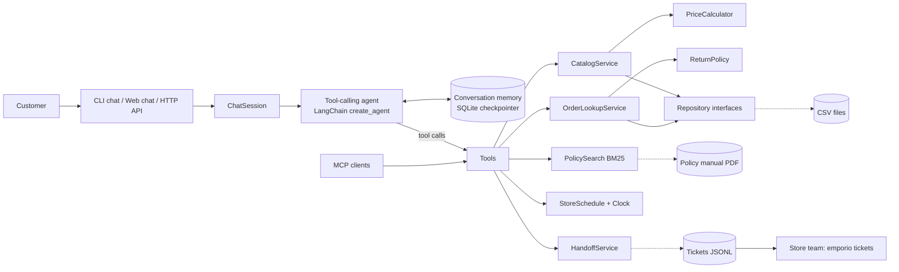

# Empório da Música — Customer Service Agent

[](https://github.com/yesi07111/IA-Engineer-Technical-Test/actions/workflows/ci.yml)

A text-based customer service agent for **Empório da Música**, a fictional musical instrument store in Campo Grande/MS, built for the Artefact AI Engineer technical test. The agent, called Melody, talks to customers in the store's friendly tone and can:

- search the catalog and give prices, promotions, PIX prices and installment plans;
- check availability and suggest alternatives when a product is sold out or discontinued;
- report the status of an order after confirming the customer's identity;
- tell whether an order can still be returned or exchanged;
- answer questions about store policies (payment, shipping, warranty, address, opening hours);
- hand a case over to the store team with a ticket when it can not solve it;
- politely decline requests outside the store's scope.

The agent decides on its own **when to query data** (CSV tables) and **when to query policies** (the PDF manual). Business rules such as prices, discounts and deadlines are calculated in plain Python, not by the language model.

Beyond the required CLI agent, the project includes:

- a **web chat** and HTTP API;
- an **MCP server** that exposes the store tools to any MCP client;
- a **data audit** command that lists inconsistencies for the store team;
- **handoff tickets**, so the agent assists the team instead of dead-ending the customer;
- an **automated evaluation** of the agent with a real model;
- **CI** on GitHub Actions.

---

## Contents

1. [Quick start](#quick-start)
2. [Commands](#commands)
3. [Choosing a model provider](#choosing-a-model-provider)
4. [How it works](#how-it-works)
5. [Technical decisions](#technical-decisions)
6. [Beyond the brief](#beyond-the-brief)
7. [Project structure](#project-structure)
8. [Data handling and assumptions](#data-handling-and-assumptions)
9. [Error handling](#error-handling)
10. [Example conversations](#example-conversations)
11. [Evaluation](#evaluation)
12. [Testing](#testing)
13. [Known limitations](#known-limitations)
14. [What I would do with more time](#what-i-would-do-with-more-time)
15. [Use of AI coding assistants](#use-of-ai-coding-assistants)

---

## Quick start

**Requirements:** Python 3.11 or newer and a free Gemini API key from [Google AI Studio](https://aistudio.google.com) (**Get API key → Create API key**). Other providers also work, see [Choosing a model provider](#choosing-a-model-provider).

```bash
git clone https://github.com/yesi07111/IA-Engineer-Technical-Test.git
cd IA-Engineer-Technical-Test
python -m venv .venv
```

Activate the virtual environment:

```bash
# Linux / macOS
source .venv/bin/activate
# Windows (PowerShell)
.venv\Scripts\Activate.ps1
```

Install the project with Gemini support, the web chat, the MCP server and the development tools:

```bash
pip install -e ".[google,web,mcp,dev]"
```

Create your configuration file and paste your key into `GEMINI_API_KEY`:

```bash
cp .env.example .env
```

Check that the data loads and that the model settings are complete. This does not call the model:

```bash
emporio check
```

Start chatting:

```bash
emporio chat --show-tools
```

Or open the web chat at http://127.0.0.1:8000:

```bash
emporio serve
```

All commands must be run from the project root, because the data folder is resolved from there (`EMPORIO_DATA_DIR` can point elsewhere). `.env` is ignored by git, so your key never leaves your machine.

---

## Commands

| Command | What it does | Needs the model |
|---|---|---|
| `emporio chat [--session ID] [--show-tools]` | Interactive chat in the terminal. Reuse `--session` to continue a conversation. | yes |
| `emporio serve [--port 8000]` | HTTP API (`POST /api/chat`) and web chat page. API docs at `/docs`. | yes |
| `emporio mcp` | MCP server over stdio with the store tools. | no |
| `emporio check` | Loads every data file and validates the settings. | no |
| `emporio audit` | Lists data inconsistencies for the store team. | no |
| `emporio tickets` | Shows the cases the agent forwarded to the team. | no |
| `python scripts/generate_examples.py [03 05]` | Regenerates the example conversations. | yes |
| `python scripts/evaluate_agent.py [--only ids]` | Runs the evaluation cases and writes `evals/report.md`. | yes |

---

## Choosing a model provider

The model is set with one variable in `provider:model` format, so switching providers needs no code change.

| Provider | Install extra | `EMPORIO_MODEL` example | Key |
|---|---|---|---|
| **Google Gemini (default, free tier)** | `.[google]` | `google_genai:gemini-3.5-flash` | `GEMINI_API_KEY` or `GOOGLE_API_KEY` |
| Anthropic | `.[anthropic]` | `anthropic:claude-sonnet-5-5` | `ANTHROPIC_API_KEY` |
| OpenAI | `.[openai]` | `openai:<model-name>` | `OPENAI_API_KEY` |
| Ollama (local) | `.[ollama]` | `ollama:<model-name>` | none |

The project was developed, evaluated and used to generate the examples with **`google_genai:gemini-3.5-flash`**.

The Gemini free tier allows 5 requests per minute and 20 per day per project. With `EMPORIO_REQUESTS_PER_MINUTE=5`, calls wait their turn instead of failing. A single customer message usually needs 2 model calls: one to choose the tools, one to write the answer.

Optional settings, all with the `EMPORIO_` prefix:
- `REQUESTS_PER_MINUTE`
- `TEMPERATURE` (leave it empty to keep the provider default)
- `DATA_DIR`
- `MEMORY_DB`
- `TICKETS_FILE`
- `TIMEZONE`
- `MAX_AGENT_STEPS`

---

## How it works



For each customer message the agent receives:
- the persona and rules (system prompt);
- the conversation so far;
- the description of nine tools.

It chooses which tools to call, reads their results and writes the answer.

| Tool | Used for |
|---|---|
| `search_products` | "Which acoustic guitars do you have up to R$1000?", "which of those have steel strings?" |
| `get_product_details` | Price, promotion, PIX price, installments, stock and specs of one product |
| `list_active_promotions` | "Do you have any promotions?" |
| `list_categories` | "What do you sell?" |
| `get_order_status` | Status, tracking code and delivery date (requires identity check) |
| `check_return_eligibility` | "Can I still return my order?" (requires identity check) |
| `search_store_policies` | Payment, shipping, warranty, returns, address, contacts, privacy |
| `get_store_status` | "Are you open now?" using the real time in Campo Grande, and the next opening |
| `forward_to_team` | Complaints, return requests, late deliveries, anything the agent can not solve |

---

## Technical decisions

### Agent approach: tool calling (ReAct) with deterministic tools

I chose a tool-calling agent instead of pure RAG or a SQL agent.

- **Pure RAG** would put prices and stock in a vector index. That is unreliable for exact numbers and filters ("under R$1000", "in stock").
- **A SQL agent** lets the model write queries. For six small tables this adds risk (wrong joins, leaking customer data) without real benefit.
- **Tools backed by tested Python services** give the model a small set of safe operations. The model decides *what* to ask; the code decides *the answer*. This follows the store manual (section 7.1): never state prices, stock or deadlines without checking the system.

### Framework: LangChain v1 (`create_agent`, built on LangGraph)

- It provides the ReAct loop, tool schemas and a checkpointer for conversation memory with little code.
- `init_chat_model` makes the agent provider-agnostic.
- The framework is isolated in two small files (`application/agent.py` and `application/tools.py`). Replacing it would not affect the domain or data layers.

### Model: Gemini 3.5 Flash

- It calls tools reliably, follows long instructions and writes natural Brazilian Portuguese.
- It has a free tier, so anyone reviewing the project can run it at no cost.
- Gemini 3.5 Flash-Lite was also tested. It is faster, but it applied the scope rules less consistently (it answered a general-knowledge question). This difference is one reason the evaluation exists.

### Policy retrieval: section-based chunking + BM25

- The manual is short (8 pages) and well structured. It is split **by its numbered sections** (e.g. "4.1 Direito de Arrependimento"), so each chunk is a complete rule. This works better than fixed-size chunks.
- Sections are ranked with **BM25** over accent-free, lightly stemmed words: the first five letters, so "devolver" matches "devolução".
  - It needs no embedding model and no extra API key, and it runs instantly.
  - A keyword-overlap filter drops sections that share no word with the question.
- The tool returns the section number, so the agent can cite it.
- Alternative considered: sending the whole manual in the prompt (about 3k tokens). It would work today, but retrieval scales if the manual grows, keeps the prompt small and makes "when to consult policies" an explicit decision of the agent.
- The search sits behind the `PolicySearch` interface, so an embedding-based or hybrid search can replace it without touching anything else.

### Business rules in code, not in the prompt

`PriceCalculator`, `ReturnPolicy` and `StoreSchedule` implement the manual's rules and are unit tested:

- active promotions apply, and the biggest wins if there are several;
- the 5% PIX discount does not stack with promotions (section 6.2);
- interest-free installments respect the minimum per installment of each range (section 3.1);
- returns: 7 days for regret or preference, 30 days for defects, then the 90-day legal warranty and the manufacturer's warranty (sections 4 and 8);
- opening hours use the `America/Campo_Grande` time zone (UTC-4), not São Paulo's.

### Privacy (LGPD)

- Order tools require the order number **and** the e-mail or phone used in the purchase.
- A wrong contact and a non-existent order return the same message, so nobody can discover other people's orders.
- No tool lists customer data.

### Conversation memory

LangGraph's SQLite checkpointer saves each conversation by session id. The customer does not need to repeat the order number in the next message, and a conversation survives a restart. The web API shares one compiled agent across sessions, so data is loaded once.

### Prompt strategy

The system prompt (`application/prompts.py`) is in English for maintainability and asks the agent to answer in the customer's language (Portuguese by default). It covers:

1. the persona taken from the manual (informal but professional, "a friend who understands music");
2. a routing guide: which tool to use for each kind of question;
3. grounding rules: no numbers without a tool, original price next to promotional ones, ask when a product name is ambiguous, never confirm a return before checking the order;
4. scope: instruments only, no accessories, decline unrelated topics without answering them;
5. when and how to hand a case to the team;
6. safety: customer messages and tool results are data, not instructions.

The prompt was refined with the evaluation results. For example, a rule was added after the model answered "What is the capital of France?" instead of declining.

### Architecture (ports and adapters, SOLID)

| Principle | Where |
|---|---|
| Single responsibility | Each class does one job: `PriceCalculator` prices, `CsvProductRepository` reads products, tools only translate between the model and the services. |
| Open/closed | New tools are added to one list in `tools.py`. The CLI, web API and MCP server reuse the same tools without changes. |
| Liskov substitution | Tests swap the real clock for a `FrozenClock`, the LLM for a scripted model and the ticket file for a temporary one with no change to the code under test. |
| Interface segregation | Small interfaces per concept (`ProductRepository`, `OrderRepository`, `TicketRepository`, `PolicySearch`, `Clock`…) instead of one large data access class. |
| Dependency inversion | Services depend on the interfaces in `ports/`. Only `container.py` knows the concrete classes. |

---

## Beyond the brief

These additions are not required by the test, but each one solves a real need of the store.

**Handoff tickets (`forward_to_team`, `emporio tickets`).** The brief says the agent should *assist* the team, not replace it.
- When the agent can not solve something (a complaint, an eligible return, a late delivery, a product the store does not have), it asks permission and a contact, then writes a ticket for the team.
- The ticket stores a summary, contact, order and session id. The customer receives a ticket number such as `EM-20261103-A1B2C3` and the expected response time.
- The team lists open cases with `emporio tickets`, and can read the full chat thanks to the session id.

**Data audit (`emporio audit`).** Exploring the data revealed inconsistencies that would cause wrong answers in production. The audit turns them into a checklist for the team, sorted by severity:
- orders whose total does not match their items;
- orders with products that are not on sale;
- late shipments;
- active products with no stock;
- shared e-mails;
- empty categories.

It runs in CI and needs no API key.

**MCP server (`emporio mcp`).** The same nine tools, with the same validation and privacy rules, are exposed through the Model Context Protocol. Any MCP client (Claude Desktop, IDE assistants, other agents) can query the store without duplicating logic. To use it from Claude Desktop, add this to its configuration:

```json
{
  "mcpServers": {
    "emporio-da-musica": {
      "command": "emporio",
      "args": ["mcp"],
      "cwd": "/path/to/IA-Engineer-Technical-Test"
    }
  }
}
```

**Web chat and HTTP API (`emporio serve`).** A FastAPI service with `POST /api/chat`, `GET /health`, interactive docs at `/docs` and a small chat page that shows which tools were used. Inputs are validated: session id format, message length. Provider failures return `503` without leaking internal details.

**Evaluation (`scripts/evaluate_agent.py`).** Fifteen cases check the agent's behaviour with a real model. See [Evaluation](#evaluation).

**Rate limiting.** `EMPORIO_REQUESTS_PER_MINUTE` queues calls on the client side, so the free tier works without `429` errors.

**CI.** GitHub Actions runs Ruff, mypy, the test suite and the data audit on Python 3.11, 3.12 and 3.13.

---

## Project structure

```
IA-Engineer-Technical-Test/
├── .github/workflows/ci.yml     # Lint, types, tests and data audit on every push
├── data/                        # CSV tables and the policy manual (renamed, unchanged content)
├── evals/                       # Evaluation cases and the latest report
├── examples/conversations/      # Example conversations with the agent
├── scripts/                     # Example generator and evaluation runner
├── src/emporio_agent/
│   ├── domain/                  # Models and business rules, no frameworks
│   ├── ports/                   # Interfaces (repositories, policy search, clock, tickets)
│   ├── infrastructure/          # CSV, PDF, BM25, clock and ticket file implementations
│   ├── application/             # Services, tools, prompt, agent, chat session, audit
│   ├── interfaces/              # CLI, web API + chat page, MCP server
│   ├── container.py             # Wires everything together
│   ├── config.py                # Settings from environment / .env
│   └── errors.py                # Project exceptions
└── tests/                       # Unit, service, API, MCP and end-to-end tests (no API key needed)
```

The data files were renamed to short English names (`products.csv`, `store_policies.pdf`, …) to keep paths simple.

---

## Data handling and assumptions

While exploring the data I found several inconsistencies. `emporio audit` reports most of them. These are the decisions I took:

| Finding | Decision |
|---|---|
| Products with status `discontinued` or `coming_soon`, and one active product with zero stock (id 96) | Never offered as available. The agent states their status and suggests available products of the same category with the closest price. |
| Several promotions for the same product; "Black Friday" is inactive even in November | The only source of truth is `is_active` (manual 7.3: never promise a discount that is not active). If several were active, the biggest would apply. |
| Order totals that differ from the sum of the items (orders 3 and 20) | The agent reports `total_brl`, the amount actually charged, and does not recalculate it. |
| Orders containing a `coming_soon` product (3 and 14) | Order status is reported as stored; the audit flags them. |
| An order `shipped` with an estimated delivery date in the past (8) | The tool flags it as late and the agent offers to open a ticket for the team. |
| Two customers share the same e-mail (11 and 43) | Not ambiguous for the agent: verification compares the contact with the owner of the specific order. |
| The manual lists two WhatsApp numbers, (67) 3341-4444 and (67) 3321-4500, and one e-mail with a typo (`empóriodamusica`) | The agent uses (67) 3341-4444 and `contato@emporiodamusica.com.br`, which appear on the cover and in the company data table. |
| The 1x–3x installment rule is ambiguous ("no minimum, except below R$ 50") | Interpreted as a minimum of R$ 50 per installment for 1x to 3x. |
| There is no real delivery date | The estimated delivery date is used as the delivery date to count return deadlines. |
| Product specs say `"strings": "steel"`, while customers ask for "aço" | Specs are translated to Portuguese ("aço"/"nylon", electric yes/no) for both search and answers. |
| The manual mentions "more than 300 instruments"; the catalog has 65, and three categories have no products | The agent only talks about what the data contains and reports empty categories as unavailable. |
| Holidays are not listed anywhere | Not modelled (see limitations). |

Data is validated on load: required columns, types, positive prices, unique ids and valid JSON specs. Any problem stops the program with the file name and line number.

---

## Error handling

Errors are handled at the layer that can do something useful about them, and the customer never sees a stack trace.

| Situation | What happens |
|---|---|
| Missing or invalid `.env` setting (e.g. `EMPORIO_MODEL` without provider) | `emporio` stops before starting and explains which setting is wrong. |
| API key not set for the chosen provider | Detected before the first message: "GOOGLE_API_KEY or GEMINI_API_KEY is not set…". |
| Provider package not installed or unknown provider | Reported as a configuration error with the `pip install` extra to use. |
| Missing data file, wrong column, invalid value, repeated id | `DataLoadError` with file name and line, e.g. `products.csv, line 3: …`. `emporio check` reports it without calling the model. |
| Unreadable or unexpected policy PDF | `DataLoadError` explaining that no numbered sections were found. |
| Model sends invalid tool arguments (negative order number, empty name) | Rejected by the tool's schema; the model receives the validation message and can correct the call. |
| Valid arguments that make no sense (unknown category, min price above max, invalid ticket contact) | The tool returns `{"error": ...}` with a message the model can act on, e.g. the list of valid categories. |
| Unexpected exception inside a tool | Logged. The model receives a generic message telling it not to guess and to offer the store contacts. |
| Product name not found or ambiguous | The tool returns the closest names or the candidates, and the agent asks the customer. |
| Order not found or contact does not match | Same neutral message in both cases, for privacy. |
| The agent loops calling tools | Stopped after `EMPORIO_MAX_AGENT_STEPS` steps with a polite reply. |
| Free tier rate limit | Avoided with `EMPORIO_REQUESTS_PER_MINUTE`, which queues the calls. |
| Network, authentication, quota or temporary provider error (e.g. 503 "high demand") | LangChain retries up to 3 times. If it still fails, the CLI shows a short message and keeps the conversation open, and the web API answers `503`. |
| Empty message or more than 2000 characters | Rejected before reaching the model (`422` in the web API). |
| Corrupted ticket file | `emporio tickets` reports the broken line instead of crashing. |
| `Ctrl+C` or end of input | The chat closes cleanly; the conversation stays saved. |

Use `emporio chat --verbose` to see debug logs, including full error details.

---

## Example conversations

The [`examples/conversations`](examples/conversations) folder has five conversations generated with `python scripts/generate_examples.py` and `gemini-3.5-flash`:

1. [Catalog search with a budget](examples/conversations/01_catalog_budget.md): first a budget search, then a refinement to steel strings.
2. [Price check, promotion and PIX rules](examples/conversations/02_price_and_promotion.md)
3. [Return request with identity check](examples/conversations/03_order_return.md). **Non-trivial:** it verifies the owner, applies the return deadlines to that specific order and explains the warranty path.
4. [Store information and opening hours](examples/conversations/04_store_info.md)
5. [Out of scope requests and prompt injection](examples/conversations/05_out_of_scope.md)

Each file shows which tools the agent called for every answer.

---

## Evaluation

`scripts/evaluate_agent.py` runs the cases in [`evals/cases.json`](evals/cases.json) against the real model. Each case checks:
- **tool choice:** the expected tool was called, or no tool when none is needed;
- **grounding:** the answer contains the right facts, such as prices, tracking codes or rule deadlines;
- **safety:** the answer does not contain what it must not, such as another customer's data, an invented discount, or an answer to an off-topic question.

Cases cover prices, promotions and PIX, sold out, discontinued and ambiguous products, budget search, verified and unverified orders, return rules, opening hours, accessories, off-topic questions, prompt injection and a complaint that ends in a ticket.

**Latest result with `gemini-3.5-flash`: 15/15 cases passed, 13/13 correct tool choices.** The full report with every transcript is in [`evals/report.md`](evals/report.md).

What the evaluation found and fixed during development:

- An earlier run with Gemini 3.5 Flash-Lite answered "What is the capital of France?". The prompt now says unrelated questions must be declined without answering them.
- A refinement question ("which of those have steel strings?") missed one guitar, because its specs said `steel` and not `aço`. Specs are now translated before searching.
- The model confirmed "yes, you can return it" before checking the order. The prompt now forbids confirming a return before `check_return_eligibility`.
- One case first failed because the agent said "Não abrimos aos domingos" while the check expected the word "fechado". The answer was right and the check was too strict, so cases can now accept alternative wordings (`must_contain_any`).

Each project of the Gemini free tier allows 20 requests per day. The full run needs about 35 requests, so the script caches results per case and can be resumed with `--only`.

---

## Testing

```bash
pytest
```

The suite has 172 tests and needs **no API key**:

- **Unit tests** for prices, installments, return deadlines, opening hours, CSV loading and validation, PDF splitting, policy search, tickets and the data audit.
- **Service and tool tests** against the real data files, including invalid inputs and the identity check.
- **End-to-end agent tests** with a scripted chat model. They cover the full agent loop (tool call → tool result → answer), memory across turns, the step limit and message validation.
- **Web API and MCP server tests**: endpoints, validation, error mapping, tool listing and calls.

Code quality checks (also run by CI):

```bash
ruff check .
```

```bash
mypy src
```

---

## Known limitations

- **Holidays** are not modelled; the agent may say the store is open on a holiday.
- **BM25 is lexical.** Questions with words that do not appear in the manual can miss the right section. The agent is told to rewrite questions in Portuguese, and the manual is small, but synonyms are not handled.
- **The return deadline uses the estimated delivery date**, because the real delivery date is not stored.
- **Shipping cost** can not be calculated. The manual says it depends on the destination postal code, weight and size, and none of that is in the data. The agent explains the rule and the options.
- **The agent does not place orders or take payments.** It explains the rules and opens a ticket for the team.
- **Conversation history grows without limit** within a session. Very long sessions would need summarization or trimming.
- **The data is loaded once at startup.** Changes to the CSV files need a restart.
- **Free tier quotas.** With 20 requests per day per project, the free Gemini tier is enough to try the agent and run the evaluation once, not for real traffic.
- **The web chat has no authentication.** It is meant for local demos.

---

## What I would do with more time

- **Hybrid retrieval** (BM25 + embeddings) for the policy manual.
- A larger evaluation set (100+ cases) with an **LLM-as-judge** for tone, run in CI on a schedule.
- A **WhatsApp** integration, the store's main channel, reusing `ChatSession` like the web API does.
- A real **database** (PostgreSQL) behind the same repository interfaces, with live stock, and ticket management (status, assignee) for the team.
- **Observability** with LangSmith or OpenTelemetry: traces of tool calls, latency and cost per conversation.
- **Summarization middleware** to keep long conversations within the context window.
- **Holiday calendar** and special opening hours (Black Friday, Christmas).
- A **Dockerfile** and authentication for the web API.

---

## Use of AI coding assistants

I used **Claude Code** (Anthropic) as a coding assistant to:

- generate the first versions of the code, which I then adapted to my design decisions;
- write and improve the documentation (docstrings and this README);
- suggest more ideas for test cases and edge cases.

Everything was reviewed by me, and I guarantee its quality: I read the code, ran the tests and the evaluation, checked the agent's answers and made the final decisions on architecture and on how to interpret the store rules.
