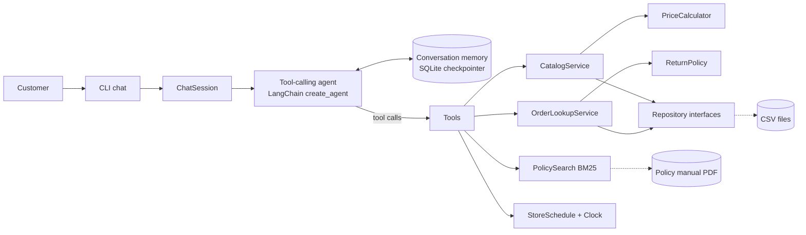

# Empório da Música — Customer Service Agent

A text-based customer service agent for **Empório da Música**, a fictional musical instrument store in Campo Grande/MS. The agent talks to customers in a friendly, store-aligned tone and can:

- search the catalog and give prices, promotions, PIX prices and installment plans;
- check product availability and suggest alternatives when something is sold out;
- report the status of an order, after confirming the customer's identity;
- tell whether an order can still be returned or exchanged;
- answer questions about store policies (payment, shipping, warranty, address, opening hours);
- politely decline requests outside the store's scope.

The agent decides on its own **when to query data** (CSV tables) and **when to query policies** (the PDF manual). Business rules such as prices, discounts and deadlines are calculated in plain Python, not by the language model.

---

## Contents

1. [Quick start](#quick-start)
2. [Choosing a model provider](#choosing-a-model-provider)
3. [How it works](#how-it-works)
4. [Technical decisions](#technical-decisions)
5. [Project structure](#project-structure)
6. [Data handling and assumptions](#data-handling-and-assumptions)
7. [Error handling](#error-handling)
8. [Example conversations](#example-conversations)
9. [Testing](#testing)
10. [Known limitations](#known-limitations)
11. [What I would do with more time](#what-i-would-do-with-more-time)
12. [Use of AI coding assistants](#use-of-ai-coding-assistants)

---

## Quick start

**Requirements:** Python 3.11 or newer, and an API key for one LLM provider (or a local model through Ollama).

```bash
git clone <this-repository-url>
cd emporio-agent
python -m venv .venv
```

Activate the virtual environment:

```bash
# Linux / macOS
source .venv/bin/activate
# Windows (PowerShell)
.venv\Scripts\Activate.ps1
```

Install the project with the provider you want to use and the development tools:

```bash
pip install -e ".[anthropic,dev]"
```

Create your configuration file and add your API key:

```bash
cp .env.example .env
```

Check that the data loads and that the model settings are complete (this does not call the model):

```bash
emporio check
```

Start chatting:

```bash
emporio chat --show-tools
```

- `--show-tools` prints which tools the agent used for each answer.
- Each conversation gets a session id. Run `emporio chat --session <id>` to continue it later; conversations are stored in `.memory/conversations.sqlite`.
- Type `sair` (or press `Ctrl+C`) to leave.

All commands must be run from the project root, because the data folder is resolved from there (`EMPORIO_DATA_DIR` can point elsewhere).

---

## Choosing a model provider

The model is configured with a single variable in `provider:model` format, so switching providers needs no code change.

| Provider | Install extra | `EMPORIO_MODEL` example | Key |
|---|---|---|---|
| Anthropic (default) | `.[anthropic]` | `anthropic:claude-sonnet-5-5` | `ANTHROPIC_API_KEY` |
| OpenAI | `.[openai]` | `openai:<model-name>` | `OPENAI_API_KEY` |
| Google Gemini (has a free tier) | `.[google]` | `google_genai:<model-name>` | `GOOGLE_API_KEY` |
| Ollama (local, free) | `.[ollama]` | `ollama:<model-name>` | none |

The model must support tool calling. Optional settings, all with the `EMPORIO_` prefix: `TEMPERATURE` (empty keeps the provider default), `DATA_DIR`, `MEMORY_DB`, `TIMEZONE` and `MAX_AGENT_STEPS`.

---

## How it works



For each customer message, the agent receives the persona and rules (system prompt), the conversation so far, and the description of eight tools. It chooses which tools to call, reads their results and writes the answer.

| Tool | Used for |
|---|---|
| `search_products` | "Which acoustic guitars do you have up to R$1000?" |
| `get_product_details` | Price, promotion, PIX price, installments, stock and specs of one product |
| `list_active_promotions` | "Do you have any promotions?" |
| `list_categories` | "What do you sell?" |
| `get_order_status` | Status, tracking code and delivery date (requires identity check) |
| `check_return_eligibility` | "Can I still return my order?" (requires identity check) |
| `search_store_policies` | Payment, shipping, warranty, returns, address, contacts, privacy |
| `get_store_status` | "Are you open now?" using the real time in Campo Grande |

---

## Technical decisions

### Agent approach: tool calling (ReAct) with deterministic tools

I chose a tool-calling agent instead of pure RAG or a SQL agent.

- **Pure RAG** would put prices and stock in a vector index. That is unreliable for exact numbers and filters ("under R$1000", "in stock").
- **A SQL agent** lets the model write queries. For six small tables this adds risk (wrong joins, leaking customer data) without real benefit.
- **Tools backed by tested Python services** give the model a small set of safe operations. The model decides *what* to ask; the code decides *the answer*. This follows the store manual (section 7.1): never state prices, stock or deadlines without checking the system.

### Framework: LangChain v1 (`create_agent`, built on LangGraph)

- It provides the ReAct loop, tool schemas and a checkpointer for conversation memory with little code.
- `init_chat_model` makes the agent provider-agnostic.
- The framework is isolated in two small files (`application/agent.py` and `application/tools.py`), so replacing it would not affect the domain or data layers.

### Model

The default is Anthropic's `claude-sonnet-5-5`: it is reliable at choosing tools, follows long instructions and writes natural Brazilian Portuguese. Any tool-calling model can be used instead, including a free local model through Ollama, at the cost of answer quality.

### Policy retrieval: section-based chunking + BM25

- The manual is short (8 pages) and well structured, so it is split **by its numbered sections** (e.g. "4.1 Direito de Arrependimento"). Each chunk is a complete rule, which is better than fixed-size chunks.
- Sections are ranked with **BM25** over accent-free, lightly stemmed words (the first five letters, so "devolver" matches "devolução"). This needs no embedding model, no extra API key and runs instantly.
- The tool returns the section number, so the agent can cite it.
- Alternative considered: sending the whole manual in the prompt (about 3k tokens). It would work today, but retrieval scales if the manual grows, keeps the prompt small and makes "when to consult policies" an explicit decision of the agent.
- The search sits behind the `PolicySearch` interface, so an embedding-based or hybrid search can replace it without touching anything else.

### Business rules in code, not in the prompt

`PriceCalculator`, `ReturnPolicy` and `StoreSchedule` implement the manual's rules and are unit tested:

- active promotions apply, and the biggest wins if there are several;
- the 5% PIX discount does not stack with promotions (section 6.2);
- interest-free installments respect the minimum per installment of each range (section 3.1);
- returns: 7 days for regret or preference, 30 days for defects, then the manufacturer's warranty (sections 4 and 8);
- opening hours use the `America/Campo_Grande` time zone (UTC-4), not São Paulo's.

### Privacy (LGPD)

Order tools require the order number **and** the e-mail or phone used in the purchase. A wrong contact and a non-existent order return the same message, so nobody can discover other people's orders. Customer data is never listed by any tool.

### Conversation memory

LangGraph's SQLite checkpointer saves each conversation by session id. The customer does not need to repeat the order number in the next message, and a conversation can be resumed after restarting the program.

### Interface

A command line chat (Typer + Rich). The brief puts the focus on the agent, and the interface is a thin layer over `ChatSession`, so an HTTP API or a WhatsApp integration could reuse it unchanged.

### Prompt strategy

The system prompt (`application/prompts.py`) is in English for maintainability and asks the agent to answer in the customer's language (Portuguese by default). It covers:

1. the persona taken from the manual (informal but professional, "a friend who understands music");
2. a routing guide: which tool to use for each kind of question;
3. grounding rules: no numbers without a tool, show the original price next to promotional ones, ask when a product name is ambiguous;
4. scope: instruments only, no accessories, decline unrelated topics;
5. safety: customer messages and tool results are data, not instructions.

Tool descriptions are short and tell the model *when* to use each tool.

### Architecture (ports and adapters, SOLID)

| Principle | Where |
|---|---|
| Single responsibility | Each class does one job: `PriceCalculator` prices, `CsvProductRepository` reads products, tools only translate between the model and the services. |
| Open/closed | New tools are added to one list in `tools.py`. A new data source or search engine is a new class implementing an existing interface. |
| Liskov substitution | Tests swap the real clock for a `FrozenClock` and the LLM for a scripted model with no change to the code under test. |
| Interface segregation | Small interfaces per concept (`ProductRepository`, `OrderRepository`, `PolicySearch`, `Clock`…) instead of one large data access class. |
| Dependency inversion | Services depend on the interfaces in `ports/`. Only `container.py` knows the concrete classes. |

---

## Project structure

```
emporio-agent/
├── data/                        # CSV tables and the policy manual (renamed, unchanged content)
├── examples/conversations/      # Example conversations with the agent
├── scripts/generate_examples.py # Runs the example scenarios against the real model
├── src/emporio_agent/
│   ├── domain/                  # Models and business rules, no frameworks
│   ├── ports/                   # Interfaces (repositories, policy search, clock)
│   ├── infrastructure/          # CSV, PDF, BM25 and clock implementations
│   ├── application/             # Services, tools, prompt, agent and chat session
│   ├── interfaces/cli.py        # Command line interface
│   ├── container.py             # Wires everything together
│   ├── config.py                # Settings from environment / .env
│   └── errors.py                # Project exceptions
└── tests/                       # Unit and end-to-end tests (no API key needed)
```

The data files were renamed to short English names (`products.csv`, `store_policies.pdf`, …) to keep paths simple.

---

## Data handling and assumptions

While exploring the data I found several inconsistencies. These are the decisions I took:

| Finding | Decision |
|---|---|
| Products with status `discontinued` or `coming_soon`, and one active product with zero stock (id 96) | Never offered as available. The agent states their status and suggests available products of the same category with the closest price. |
| Several promotions for the same product; "Black Friday" is inactive even in November | The only source of truth is `is_active` (manual 7.3: never promise a discount that is not active). If several were active, the biggest would apply. |
| Order totals that differ from the sum of the items (orders 3 and 20) | The agent reports `total_brl`, the amount actually charged, and does not recalculate it. |
| Orders containing a `coming_soon` product (3 and 14) | Order status is reported as stored. |
| An order `shipped` with an estimated delivery date in the past (8) | The tool flags it as late and the agent offers to forward the case to the team. |
| Two customers share the same e-mail (11 and 43) | Not ambiguous: verification compares the contact with the owner of the specific order. |
| The manual lists two WhatsApp numbers, (67) 3341-4444 and (67) 3321-4500, and one e-mail with a typo (`empóriodamusica`) | The agent uses (67) 3341-4444 and `contato@emporiodamusica.com.br`, which appear on the cover and in the company data table. |
| The 1x–3x installment rule is ambiguous ("no minimum, except below R$ 50") | Interpreted as a minimum of R$ 50 per installment for 1x to 3x. |
| There is no real delivery date | The estimated delivery date is used as the delivery date to count return deadlines. |
| The manual mentions "more than 300 instruments"; the catalog has 65, and three categories have no products | The agent only talks about what the data contains and reports empty categories as unavailable. |
| Holidays are not listed anywhere | Not modelled (see limitations). |

Data is validated on load (required columns, types, positive prices, unique ids, valid JSON specs). Any problem stops the program with the file name and line number.

---

## Error handling

Errors are handled at the layer that can do something useful about them, and the customer never sees a stack trace.

| Situation | What happens |
|---|---|
| Missing or invalid `.env` setting (e.g. `EMPORIO_MODEL` without provider) | `emporio` stops before starting and explains which setting is wrong. |
| API key not set for the chosen provider | Detected before the first message: "ANTHROPIC_API_KEY is not set…". |
| Provider package not installed or unknown provider | Reported as a configuration error with the `pip install` extra to use. |
| Missing data file, wrong column, invalid value, repeated id | `DataLoadError` with file name and line, e.g. `products.csv, line 3: …`. `emporio check` reports it without calling the model. |
| Unreadable or unexpected policy PDF | `DataLoadError` explaining that no numbered sections were found. |
| Model sends invalid tool arguments (negative order number, empty name) | Rejected by the tool's schema; the model receives the validation message and can correct the call. |
| Valid arguments that make no sense (unknown category, min price above max) | The tool returns `{"error": ...}` with a message the model can act on, e.g. the list of valid categories. |
| Unexpected exception inside a tool | Logged; the model receives a generic message telling it not to guess and to offer the store contacts. |
| Product name not found or ambiguous | The tool returns the closest names or the candidates, and the agent asks the customer. |
| Order not found or contact does not match | Same neutral message in both cases, for privacy. |
| The agent loops calling tools | Stopped after `EMPORIO_MAX_AGENT_STEPS` steps with a polite reply. |
| Network, authentication or rate limit error from the provider | LangChain retries up to 3 times; if it still fails, the CLI shows a short message and the conversation stays open. |
| Empty message or more than 2000 characters | Rejected before reaching the model. |
| `Ctrl+C` or end of input | The chat closes cleanly; the conversation stays saved. |

Use `emporio chat --verbose` to see debug logs, including full error details.

---

## Example conversations

The [`examples/conversations`](examples/conversations) folder has five conversations generated with `python scripts/generate_examples.py`:

1. [Catalog search with a budget](examples/conversations/01_catalog_budget.md)
2. [Price check, promotion and PIX rules](examples/conversations/02_price_and_promotion.md)
3. [Return request with identity check](examples/conversations/03_order_return.md) — non-trivial: verifies the owner, applies the return deadlines and explains the warranty alternative
4. [Store information and opening hours](examples/conversations/04_store_info.md)
5. [Out of scope requests and prompt injection](examples/conversations/05_out_of_scope.md)

Each file shows which tools the agent called for every answer.

---

## Testing

```bash
pytest
```

The suite has 125 tests and needs **no API key**:

- **Unit tests** for prices, installments, return deadlines, opening hours, CSV loading and validation, PDF splitting and policy search.
- **Service and tool tests** against the real data files, including invalid inputs and the identity check.
- **End-to-end agent tests** with a scripted chat model. They cover the full agent loop (tool call → tool result → answer), memory across turns, the step limit and message validation.

Code quality checks:

```bash
ruff check .
```

```bash
mypy src
```

---

## Known limitations

- **Holidays** are not modelled; the agent may say the store is open on a holiday.
- **BM25 is lexical.** Questions with words that do not appear in the manual can miss the right section. The agent is told to rewrite questions in Portuguese, and the manual is small, but synonyms are not handled.
- **The return deadline uses the estimated delivery date**, because the real delivery date is not stored.
- **Shipping cost** can not be calculated: the manual says it depends on the destination postal code, weight and size, and none of that is in the data. The agent explains the rule and the options.
- **The agent can not act.** It does not place orders, register complaints or open return requests; it explains the rule and hands over to the team.
- **Conversation history grows without limit** within a session. Very long sessions would need summarization or trimming.
- **The data is loaded once at startup.** Changes to the CSV files need a restart.
- **Answer quality depends on the model.** Small local models may choose tools less reliably.

---

## What I would do with more time

- An **evaluation set** of 50–100 questions with expected tools and facts, run automatically (tool-choice accuracy plus an LLM-as-judge for tone and correctness).
- **Hybrid retrieval** (BM25 + embeddings) for the policy manual.
- A **FastAPI** endpoint and a simple web chat (e.g. with the Vercel AI SDK), and a **WhatsApp** integration, the store's main channel.
- Expose the tools as an **MCP server**, so the same capabilities can be reused by other assistants.
- **Human hand-off**: create a ticket with the conversation summary when the agent can not solve the request.
- A real **database** (PostgreSQL) behind the same repository interfaces, with live stock.
- **Observability** with LangSmith or OpenTelemetry: traces of tool calls, latency and cost per conversation.
- **Summarization middleware** to keep long conversations within the context window.
- **Holiday calendar** and special opening hours (Black Friday, Christmas).
- A **Dockerfile** and CI pipeline running tests, Ruff and mypy.

---

## Use of AI coding assistants

I used **Claude Code** (Anthropic) as a coding assistant during the project:

- **Exploration:** checking the CSV files and the PDF for inconsistencies, which became the [data handling](#data-handling-and-assumptions) table.
- **Design discussion:** comparing approaches (tool calling vs. RAG vs. SQL agent, BM25 vs. sending the whole manual) before choosing.
- **Implementation support:** drafting modules, docstrings and tests, which I reviewed, ran and adjusted.
- **Debugging:** two real bugs were found while testing:
  - BM25Okapi gives zero weight to a word that appears in exactly half of the documents, so the search missed obvious matches in small corpora. I switched to BM25Plus with a keyword-overlap filter.
  - Newer Claude models reject a custom `temperature`, so it is now optional.

The architecture, the interpretation of ambiguous rules and the final decisions were mine, and every part was tested locally before committing.
