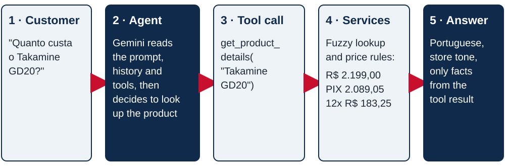

# 1. Overview

## 1.1 Executive summary

Empório da Música is a musical instrument store in Campo Grande/MS. Its staff spends a large part of the day answering recurring questions about opening hours, order status, prices and product availability. This project delivers **Melody**, a text-based customer service agent prototype that answers these questions on the store's behalf and assists the team with the cases it can not solve.

The solution is a Python application built around a **tool-calling (ReAct) agent** running on **Google Gemini 3.5 Flash**. The language model interprets each customer message and decides which information it needs. Every fact it states (prices, stock, deadlines, order data, store rules) comes from deterministic, tested Python services that read the store's data files and its policy manual.

| Indicator | Result |
|---|---|
| Behavioural evaluation with the real model (15 scenarios) | **15/15 passed**, 13/13 correct tool selections |
| Automated test suite (no API key required) | **178 tests passing** |
| Static quality checks | Ruff (lint and format) and mypy with no findings |
| Continuous integration | GitHub Actions on Python 3.11, 3.12 and 3.13 |
| Delivery channel | Command line chat (core); web chat, HTTP API and MCP server (optional extras) |

The solution separates a **deliberately simple core**, which fully answers the brief, from a set of **optional extras** that go beyond it (section 1.2).

## 1.2 A simple core and optional extras

The brief asks for the simplest solution that works. The core is kept small on purpose:

| Core element | Simple choice | What it avoids |
|---|---|---|
| Agent | One LLM with tool calling (ReAct) | Multiple agents, planners or routing classifiers |
| Tools | Eight plain Python functions, one per kind of question | Generic, model-written queries |
| Data | CSV files read into memory at startup | A database, SQL generation or a vector store |
| Policies | Manual split by numbered section, searched with BM25 | Embeddings, an extra model or an extra API key |
| Calculations | Prices, PIX, installments and deadlines in Python | Arithmetic done by the language model |
| Interface | Command line chat | Building a front end before the agent works |

**Why it works.** The store's questions are factual and closed: a price, a stock level, an order status, a rule from the manual. Exact lookups answer them better than a more complex retrieval pipeline would:

- every number is correct to the cent;
- each rule is applied exactly as the manual states it;
- each answer can be traced to a tool result.

The model only does what it is good at: understanding the customer, choosing the right tool and replying in the store's tone. The evaluation confirms the approach: 15 of 15 scenarios pass with this core.

**Optional extras.** The following additions are not needed to run or evaluate the core:

- handoff tickets for the store team;
- a data audit command;
- a web chat and HTTP API;
- an MCP server;
- the evaluation script;
- rate limiting, CI and the documentation PDF builder.

They show how the core could grow into a product, and each one reuses the same tools and rules without changing them. The light layering of the code (section 2) is what lets them plug in without touching the core.

## 1.3 Business problem

All customer service is handled manually. Most questions are repetitive and can be answered from information the store already has: the product catalog, order records, promotions and the internal policy manual. Wrong answers carry a real cost. The manual itself warns that incorrect prices or deadlines frustrate customers and may constitute misleading advertising (section 7.1).

## 1.4 Objectives

The brief asks for an agent that must:

1. adopt a persona aligned with the store's identity and tone;
2. receive and answer messages based on the information provided;
3. know when to consult operational data (availability, prices, order status) and when to consult policies (returns, opening hours, payment methods);
4. handle questions outside the store's scope appropriately.

Python is the only mandatory technical constraint. The model, provider, framework, interface and persistence strategy were free choices; they are justified in [3. Technical Decisions](03-technical-decisions.md).

## 1.5 Inputs provided

| Source | Content | Size |
|---|---|---|
| `products.csv` | Catalog with price, stock, status and technical specifications | 65 products |
| `categories.csv` | Product categories | 9 categories |
| `promotions.csv` | Promotions with discount and active flag | 25 promotions, 4 active |
| `orders.csv`, `order_items.csv` | Orders, status, tracking and items | 20 orders, 22 items |
| `customers.csv` | Customer contact data | 50 customers |
| `store_policies.pdf` | Customer service policies and procedures manual | 8 pages, 25 sections |

## 1.6 Capabilities

| Capability | Description | Part |
|---|---|---|
| Catalog search | Filters by category, keywords (including string type and electronics) and budget, sorted by price. | Core |
| Product details | Price, active promotion, PIX price, installment plan, stock and specifications. Tolerates typos and model codes written in different ways ("takamine gd 20"). | Core |
| Availability handling | Sold out, discontinued and upcoming products are never offered as available; similar alternatives are suggested. | Core |
| Order status | Status, tracking code, delivery estimate and late-delivery warning, shown only after identity verification. | Core |
| Return eligibility | Applies the regret, defect, preference and warranty rules to a specific order. | Core |
| Store policies | Answers from the relevant sections of the manual and cites the section number. | Core |
| Opening hours | Uses the real time in Campo Grande and states the next opening when the store is closed. | Core |
| Team handoff | Opens a ticket with a summary for the staff, with the customer's consent. | Extra |
| Scope control | Declines accessories (not sold by the store), unrelated topics and attempts to change the rules. | Core |

## 1.7 How one message is processed

For each customer message, the agent receives three inputs:

- the system prompt with the persona and rules;
- the conversation history;
- the description of the eight core tools, plus the optional `forward_to_team`.

The model either answers directly or requests one or more tool calls. The tools run in Python and return structured results, and the model writes the final answer from them. The conversation is saved after every turn, so later messages keep their context.

*Figure 1. Processing of one customer message.*
