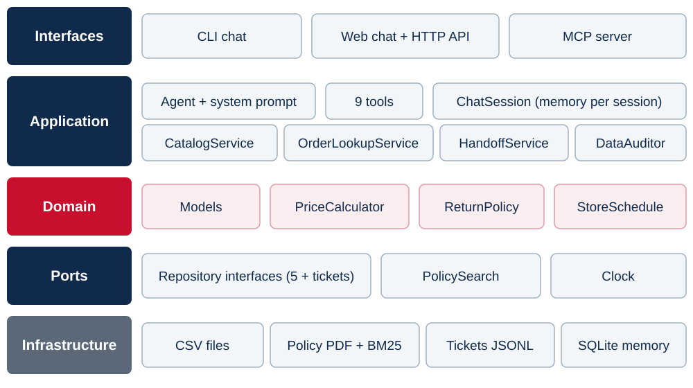

# 2. Architecture

## 2.1 Layered design

The code follows a **ports and adapters** (hexagonal) architecture. Business rules have no dependency on frameworks, files or the language model. Application and domain code depend only on the interfaces in `ports/`. Infrastructure classes implement those interfaces, and `container.py` is the only module that wires concrete classes together.

*Figure 2. Layers of the solution.*

| Layer | Responsibility | Main modules |
|---|---|---|
| Domain | Store entities and business rules, pure Python | `models`, `pricing`, `returns`, `store_hours` |
| Ports | Interfaces the application depends on | `repositories`, `policy_search`, `clock` |
| Infrastructure | Concrete implementations: CSV, PDF, BM25, clock, ticket file | `csv_repositories`, `policy_pdf`, `bm25_policy_search`, `jsonl_tickets` |
| Application | Use cases, agent tools, prompt, chat session, audit | `catalog`, `orders`, `handoff`, `tools`, `agent`, `chat`, `data_audit` |
| Interfaces | Delivery channels | `cli`, `web`, `mcp_server` |
| Composition root | The only module that knows the concrete classes | `container` |

## 2.2 Design principles (SOLID)

| Principle | Application in the project |
|---|---|
| Single responsibility | Each class has one job: `PriceCalculator` prices, `CsvProductRepository` reads products, and tools only translate between the model and the services. |
| Open/closed | New tools are added to one registry. The CLI, web API and MCP server reuse the same tools without modification. |
| Liskov substitution | Tests replace the clock, the language model and the ticket storage with test doubles, with no change to the code under test. |
| Interface segregation | Small, focused interfaces (`ProductRepository`, `OrderRepository`, `TicketRepository`, `PolicySearch`, `Clock`) instead of a single data access class. |
| Dependency inversion | Services depend on abstractions in `ports/`. Only `container.py` wires concrete implementations. |

## 2.3 Agent tools

| Tool | Purpose | Data source |
|---|---|---|
| `search_products` | Catalog search with filters | Products, categories, promotions |
| `get_product_details` | Full details of one product | Products, promotions |
| `list_active_promotions` | Current promotions | Promotions |
| `list_categories` | Categories and available counts | Categories, products |
| `get_order_status` | Order status with identity check | Orders, customers |
| `check_return_eligibility` | Return and exchange rules for one order | Orders, customers, return rules |
| `search_store_policies` | Relevant sections of the manual | Policy PDF |
| `get_store_status` | Open now, weekly hours, next opening | Clock, schedule |
| `forward_to_team` | Ticket for the store team | Ticket storage |

Every tool validates its input with a schema. Errors are returned to the model as clear messages instead of interrupting the conversation (see [6. Security and Error Handling](06-security-and-error-handling.md)).

## 2.4 Repository layout

| Path | Content |
|---|---|
| `src/emporio_agent/` | Application code, organised by the layers above |
| `data/` | CSV tables and policy manual (renamed, content unchanged) |
| `docs/` | This technical documentation and its diagrams |
| `examples/conversations/` | Example conversations generated with the real model |
| `evals/` | Evaluation scenarios and the latest report |
| `scripts/` | Example generator, evaluation runner and documentation PDF builder |
| `tests/` | Unit, service, interface and end-to-end tests |
| `.github/workflows/` | Continuous integration |
